<p align="center"></p>

# Synthrax

**Medicines that stay in sync between a care home, its GP and its pharmacy, even when the internet doesn't.**

## The problem

When a GP changes a care home resident's medicine, the change reaches the home by phone, email
or letter, if someone picks up and writes it down. The home's copy of the prescription goes out
of date silently, and nobody finds out until a wrong dose has been given. Around 7 in 10 care home
residents are exposed to at least one medication error on a given day (CHUMS study, Barber et al., 2009).

## What Synthrax does

The care home, GP practice and pharmacy each run their own copy of Synthrax, with their own copy of
the records. Copies sync whenever they can reach each other, with no central server, and each site
keeps working safely on its own when cut off.

- **Notices what it should have heard.** Margaret's blood test (INR) was taken, no dosing
  instruction has arrived and the home can't reach the GP, so warfarin is held at the 6pm round.
- **AI for words, rules for safety.** The AI turns a carer's messy note into proper records and
  writes 3-line summaries for the GP. Holds and warnings come from plain, readable rules written
  with a pharmacist, and they work offline with the AI switched off.
- **Humans decide.** The AI only drafts. Only the GP changes a medicine. After a reconnect,
  anything that happened offline appears as a conflict card for the GP to review.
- **The pack carries the version.** Every pharmacy label has a QR code with the prescription
  version, so an offline care home can still tell a newer prescription exists.

## Run it

Needs Python 3.10 or newer.

```bash
python3 -m venv .venv
source .venv/bin/activate            # Windows: .venv\Scripts\activate
pip install -r requirements.txt
cp .env.example .env                 # set DEMO_MODE=1 to use the cached AI answers
```

Start everything (clock + three sites) in one terminal:

```bash
./run_all.sh --fresh
```

Or one per terminal tab:

```bash
python -m control.clock_server
python -m node.main --node carehome
python -m node.main --node gp
python -m node.main --node pharmacy
```

| Site | Screen | API docs |
|---|---|---|
| Care home | http://localhost:8001 | http://localhost:8001/docs |
| GP practice | http://localhost:8002 | http://localhost:8002/docs |
| Pharmacy | http://localhost:8003 | http://localhost:8003/docs |

Reset to the starting state (stop the sites first): `python reset_demo.py`

Run the tests: `pytest`

Every safety rule is checked against the pharmacy lead's 37 written test cases (each must fire
when it should and stay silent when it shouldn't): `pytest tests/test_rule_cases.py -v`

## Running the demo

### First-time setup

```bash
python -m venv .venv
source .venv/bin/activate        # Windows: .venv\Scripts\activate
pip install -r requirements.txt
cp .env.example .env             # then add LLM_API_KEY if you want live AI
```

### Start everything

```bash
bash run_all.sh --fresh
```

This starts the demo clock and all three sites, then opens them in your browser:

| Site | Address |
|---|---|
| Care home | http://localhost:8001 |
| GP | http://localhost:8002 |
| Pharmacy | http://localhost:8003 |

`--fresh` deletes the old databases so the demo starts from the seed data.
Leave it off to keep what you did last time. Press Ctrl+C to stop everything.

### Run the tests

```bash
python -m pytest -q
```

## Troubleshooting

**`zsh: permission denied: ./run_all.sh`**
The script isn't marked as runnable. Use `bash run_all.sh --fresh`, or run
`chmod +x run_all.sh` once.

**`ImportError: cannot import name 'field_validator' from 'pydantic'`**
You're outside the project environment (Anaconda's base has an old pydantic).
Run `source .venv/bin/activate` and try again. Your prompt shows `(.venv)` when
it's active. You need to do this in every new terminal.

**`ModuleNotFoundError: No module named 'nicegui'` (or `segno`, `httpx`)**
Same cause as above, or the packages aren't installed yet:
`source .venv/bin/activate` then `pip install -r requirements.txt`.

**`address already in use` when starting**
An earlier run is still going. Press Ctrl+C in its terminal, or stop it with
`lsof -ti :8000,:8001,:8002,:8003 | xargs kill`.

**The time on screen doesn't move**
The sites can't reach the clock. Check `CLOCK_URL` in `.env` is
`http://localhost:8000`.

**"The AI couldn't read this note"**
With `DEMO_MODE=1` only the prepared demo note has a cached answer. For any
other note set `DEMO_MODE=0` and `LLM_API_KEY` in `.env`, and make sure the
site is online.

**The screens show old data**
Restart with `bash run_all.sh --fresh`.

## The demo story (about 3 minutes)

1. **12:00:** switch the care home's **Network** off. Its status turns red.
2. **14:00:** at the GP, change Margaret's warfarin from 5mg to 3mg (INR too high).
   The pharmacy, still online, gets it and shows a new v2 pack with its QR code.
3. **16:00:** the GP's inbox warns the care home hasn't acknowledged the change (R7).
4. **18:00** (**Next round**): the offline care home still thinks it's 5mg. Rule R1 holds
   warfarin: INR taken 32h ago, nothing heard, no contact with the GP. Staff tap **Record held**.
5. **AI note:** read Doris's messy note. The AI drafts a refusal and a stock count of 3, staff
   confirm, and a repeat request is drafted.
6. **Reconnect:** switch the network back on. Records merge, the care home acknowledges 3mg,
   and the GP sees the conflict card "Warfarin held at 18:00" and marks it reviewed. No harm done.

**Stretch moments:** type a pack code such as `R1|M1|warfarin|3mg|v2` into the care home's
pack scanner to see R3 spot the newer prescription, or prescribe ibuprofen for Margaret at the GP
and watch the pharmacy's safety check (R6) block it because she takes warfarin.

## How it's built

All Python. Each site is one process: a FastAPI app with NiceGUI screens.

```
core/          pure logic: no network, no UI, no real clock
  types.py       shared data model (events, prescriptions, flags)
  derive.py      event log -> current doses, versions, stock, requests
  rules/         safety rules R1-R7 (offline, deterministic)
  interactions.py  R6's table of dangerous combinations
  conflicts.py   conflict cards after a reconnect
  schedule.py    dose times <-> demo-clock minutes
node/          one running site
  main.py        starts a site: screens, API, sync and clock loops
  store.py       append-only SQLite event log (never edited, never duplicated)
  sync.py        pulls missing events from the other sites every 2s
  api.py         endpoints for the other sites and for testing
  actions.py     everything a person can do, with role checks
  seed_loader.py loads data/seed_data.json at start-up
  agent/         AI: carer notes, GP summaries (with rule-based fallbacks)
  ui/            the three screens
control/       the shared demo clock (never switched off)
data/          seed_data.json and rule_test_cases.json (the site databases are created here)
assets/        logo and icons
tests/         pytest suite, including the 37 rule test cases
```

## Safety rules

| Rule | Fires when | What happens |
|---|---|---|
| R1 | INR taken over 24h ago, no dosing instruction received, cut off from the GP, warfarin due | Hold; confirm with the surgery or NHS 111 |
| R2 | High-risk medicine due and no contact with the GP for over 24h | Warn; second staff signature |
| R3 | Scanned pack is a newer prescription, an old pack, or the wrong resident's pack | Hold |
| R4 | Time-critical dose (e.g. Parkinson's) given more than 30 minutes late, or not recorded | Warn |
| R5 | Under 7 days' stock and nothing ordered | Draft a repeat request |
| R6 | New medicine clashes with what the resident already takes, or methotrexate written as daily (pharmacy) | Block or flag for pharmacist review before dispensing |
| R7 | GP's dose change not acknowledged by the care home after 2h (GP) | Warn: phone the home |

## Responsible AI

- The AI never prescribes, changes a dose or makes a safety decision. It drafts; people confirm.
- AI output must be valid structured data. Anything malformed falls back to a manual form.
- The AI sees only the text it needs, with no names or NHS numbers.
- Switch the AI off and every safety feature still works.
- The event log only grows, so there is a full audit trail of who did what, when, on which version.

All residents and data are fictional. A real deployment would need NHS clinical safety sign-off
(DCB0129/DCB0160) and data protection compliance, starting with a pilot of one care home, its GP
and its pharmacy.

## Team

| Role | Owns |
|---|---|
| Pharmacy lead | Clinical rules, seed data, test cases, pitch |
| Coder A | Event log, sync, network switch, clock, actions, conflict cards |
| Coder B | Safety rules, AI agent |
| Coder C | Screens, pack codes, rule test cases |